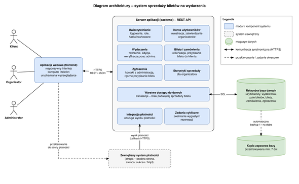

# Architektura systemu

Diagram: [`architektura.drawio`](architektura.drawio) / [`architektura.png`](architektura.png)

System ma architekturę trójwarstwową (klient – serwer – baza danych) z backendem udostępniającym REST API.

| Komponent | Odpowiedzialność |
|---|---|
| **Aplikacja webowa (frontend)** | Interfejs dla Klienta, Organizatora i Administratora; responsywny (komputer i telefon). Komunikuje się z backendem wyłącznie przez HTTPS (REST/JSON). Podczas płatności pokazuje wskaźnik postępu i nie blokuje interfejsu. |
| **Serwer aplikacji (backend)** | Cała logika biznesowa, podzielona na moduły: uwierzytelnianie (role, hasła hashowane), konta użytkowników, wydarzenia, bilety i zamówienia, zgłoszenia, statystyki sprzedaży, integracja płatności, zadania cykliczne. |
| **Warstwa dostępu do danych** | Jedyne miejsce, które komunikuje się z bazą. Rezerwacja i przypisanie biletu odbywają się w transakcji, co wyklucza podwójną sprzedaż tego samego biletu. |
| **Relacyjna baza danych** | Przechowuje użytkowników, wydarzenia, pule biletów, bilety, zamówienia i zgłoszenia. |
| **Kopia zapasowa** | Automatyczny backup bazy raz na dobę, przechowywany co najmniej 7 dni. |
| **Zewnętrzny system płatności** | W projekcie atrapa – osobna strona, na którą frontend przekierowuje klienta. Wynik płatności (sukces / błąd) trafia do modułu integracji płatności przez callback HTTPS. Dane kart nie trafiają do naszego systemu. |

## Przepływ zakupu biletu

1. Klient wybiera wydarzenie we frontendzie; frontend wysyła żądanie do backendu.
2. Moduł *Bilety i zamówienia* rezerwuje bilet (transakcja w bazie).
3. Frontend przekierowuje klienta do zewnętrznego systemu płatności.
4. System płatności wysyła wynik do modułu *Integracja płatności*.
5. Przy sukcesie bilet zostaje przypisany do klienta; przy błędzie rezerwacja jest anulowana.
   Rezerwacje, które nie zostały opłacone w czasie, zwalnia moduł *Zadania cykliczne*.

Konkretne technologie poszczególnych komponentów opisuje plik ze stosem technologicznym.

## Powiązanie z wymaganiami niefunkcjonalnymi

| Wymaganie | Jak jest spełnione w architekturze |
|---|---|
| Bezpieczeństwo | HTTPS między wszystkimi komponentami, hasła hashowane w module uwierzytelniania, dane kart obsługuje wyłącznie system płatności. |
| Niezawodność | Codzienna kopia zapasowa bazy przechowywana min. 7 dni. |
| Wydajność | Lista wydarzeń pobierana jednym zapytaniem REST z bazy (cel: < 3 s). |
| Responsywność | Płatność odbywa się poza naszym systemem, frontend pokazuje wskaźnik postępu. |
| Spójność danych | Transakcje w warstwie dostępu do danych. |
| Użyteczność | Responsywny frontend działający na komputerze i telefonie. |
