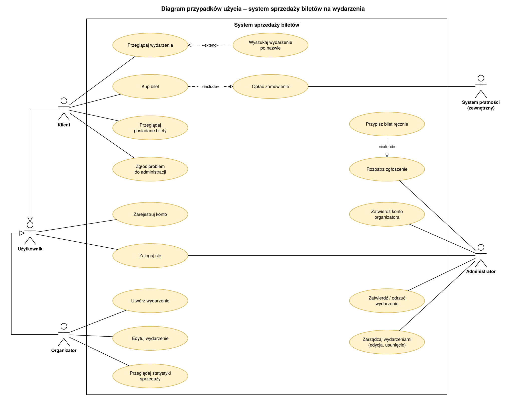

# Przypadki użycia

Diagram: [`przypadki_uzycia.drawio`](przypadki_uzycia.drawio) / [`przypadki_uzycia.png`](przypadki_uzycia.png)

## Aktorzy

| Aktor | Opis |
|---|---|
| Użytkownik | Aktor abstrakcyjny – wspólne funkcje Klienta i Organizatora (rejestracja, logowanie). |
| Klient | Osoba przeglądająca wydarzenia i kupująca bilety. |
| Organizator | Osoba lub firma tworząca wydarzenia z pulą biletów; konto wymaga zatwierdzenia przez Administratora. |
| Administrator | Zatwierdza konta organizatorów i wydarzenia, rozpatruje zgłoszenia, może ręcznie przypisać bilet. |
| System płatności | Zewnętrzny system (w projekcie – atrapa w postaci osobnej strony), zwraca informację, czy płatność się powiodła. |

## Lista przypadków użycia

| ID | Przypadek użycia | Aktor główny |
|---|---|---|
| UC-01 | Zarejestruj konto | Użytkownik (Klient / Organizator) |
| UC-02 | Zaloguj się | Użytkownik, Administrator |
| UC-03 | Przeglądaj wydarzenia | Klient |
| UC-04 | Wyszukaj wydarzenie po nazwie («extend» UC-03) | Klient |
| UC-05 | **Kup bilet** | Klient |
| UC-06 | Opłać zamówienie («include» w UC-05) | Klient, System płatności |
| UC-07 | Przeglądaj posiadane bilety | Klient |
| UC-08 | Zgłoś problem do administracji | Klient |
| UC-09 | **Utwórz wydarzenie** | Organizator |
| UC-10 | Edytuj wydarzenie | Organizator |
| UC-11 | Przeglądaj statystyki sprzedaży | Organizator |
| UC-12 | Zatwierdź konto organizatora | Administrator |
| UC-13 | Zatwierdź / odrzuć wydarzenie | Administrator |
| UC-14 | Zarządzaj wydarzeniami (edycja, usunięcie) | Administrator |
| UC-15 | Rozpatrz zgłoszenie | Administrator |
| UC-16 | Przypisz bilet ręcznie («extend» UC-15) | Administrator |

---

## UC-05: Kup bilet

| | |
|---|---|
| **Aktor główny** | Klient |
| **Aktorzy pomocniczy** | System płatności |
| **Cel** | Klient kupuje bilet na wybrane wydarzenie i otrzymuje go na swoim koncie. |
| **Warunki początkowe** | Klient jest zalogowany. Wydarzenie jest zatwierdzone przez Administratora i ma dostępne bilety w puli. |
| **Wyzwalacz** | Klient wybiera opcję „Kup bilet” na stronie wydarzenia. |

**Scenariusz główny**

1. Klient otwiera szczegóły wybranego wydarzenia (UC-03).
2. Klient wybiera liczbę biletów i klika „Kup bilet”.
3. System sprawdza dostępność biletów w puli i rezerwuje je na czas płatności (np. 10 minut).
4. System wyświetla podsumowanie zamówienia (wydarzenie, liczba biletów, cena).
5. Klient potwierdza zamówienie.
6. System przekierowuje Klienta do Systemu płatności (UC-06).
7. Klient dokonuje płatności.
8. System płatności zwraca informację o powodzeniu płatności.
9. System w jednej transakcji oznacza zamówienie jako opłacone i przypisuje bilety do konta Klienta.
10. System wyświetla potwierdzenie zakupu; bilety są widoczne w „Moich biletach” (UC-07).

**Scenariusze alternatywne i wyjątkowe**

- **3a. Brak wystarczającej liczby biletów w puli**
  1. System informuje, że bilety są wyprzedane lub dostępna jest mniejsza liczba biletów.
  2. Klient zmienia liczbę biletów (powrót do kroku 2) lub rezygnuje – koniec przypadku.
- **5a. Klient rezygnuje przed płatnością / mija czas rezerwacji**
  1. System anuluje zamówienie i zwalnia zarezerwowane bilety do puli – koniec przypadku.
- **8a. Płatność odrzucona**
  1. System płatności zwraca informację o niepowodzeniu.
  2. System wyświetla komunikat błędu i proponuje ponowienie płatności (powrót do kroku 6) albo anulowanie zamówienia (bilety wracają do puli).
- **9a. Płatność przyjęta, ale błąd systemu przy przypisaniu biletu**
  1. System zapisuje zamówienie ze statusem „opłacone – bilet nieprzypisany” i informuje Klienta o problemie.
  2. Klient zgłasza problem do administracji (UC-08).
  3. Administrator rozpatruje zgłoszenie (UC-15) i przypisuje bilet ręcznie (UC-16) lub – jeśli to niemożliwe – zleca zwrot pieniędzy.

**Warunki końcowe**

- Sukces: bilety są przypisane do konta Klienta, liczba dostępnych biletów w puli zmniejszona, zamówienie ma status „opłacone”.
- Niepowodzenie: zamówienie anulowane, bilety wróciły do puli, Klient nie został obciążony.

**Powiązane wymagania:** zakup biletu (MUST), przypisanie biletu do listy klienta (MUST), informacja zwrotna z systemu płatności (MUST), brak podwójnej sprzedaży biletu (wymaganie niefunkcjonalne – spójność danych).

---

## UC-09: Utwórz wydarzenie

| | |
|---|---|
| **Aktor główny** | Organizator |
| **Aktorzy pomocniczy** | Administrator (zatwierdza wydarzenie – UC-13) |
| **Cel** | Organizator dodaje nowe wydarzenie z pulą biletów, które po zatwierdzeniu staje się widoczne dla klientów. |
| **Warunki początkowe** | Organizator jest zalogowany, a jego konto zostało zatwierdzone przez Administratora (UC-12). |
| **Wyzwalacz** | Organizator wybiera opcję „Dodaj wydarzenie” w swoim panelu. |

**Scenariusz główny**

1. Organizator otwiera formularz nowego wydarzenia.
2. Organizator podaje dane: nazwę, opis, datę i godzinę, miejsce, liczbę biletów w puli i cenę biletu.
3. Organizator zatwierdza formularz.
4. System sprawdza poprawność danych (wymagane pola, data w przyszłości, liczba biletów > 0, cena ≥ 0).
5. System zapisuje wydarzenie w bazie danych ze statusem „oczekuje na weryfikację” i informuje o tym Organizatora.
6. Administrator weryfikuje wydarzenie i je zatwierdza (UC-13).
7. System zmienia status wydarzenia na „opublikowane” i udostępnia pulę biletów do sprzedaży.
8. Wydarzenie pojawia się na liście wydarzeń widocznej dla Klientów (UC-03).

**Scenariusze alternatywne i wyjątkowe**

- **2a. Organizator przerywa tworzenie wydarzenia**
  1. System nie zapisuje danych – koniec przypadku.
- **4a. Dane niepoprawne lub niekompletne**
  1. System wskazuje błędne pola i nie zapisuje wydarzenia.
  2. Organizator poprawia dane – powrót do kroku 3.
- **6a. Administrator odrzuca wydarzenie**
  1. System zmienia status na „odrzucone” i zapisuje powód odrzucenia widoczny dla Organizatora.
  2. Organizator kontaktuje się z Administratorem lub poprawia wydarzenie (UC-10) i wysyła je ponownie do weryfikacji – powrót do kroku 5.
- **Warunek początkowy niespełniony: konto Organizatora niezatwierdzone**
  1. System nie pozwala otworzyć formularza i wyświetla informację, że konto czeka na zatwierdzenie.

**Warunki końcowe**

- Sukces: wydarzenie jest zapisane w bazie danych ze statusem „opublikowane”, a jego pula biletów jest dostępna do sprzedaży.
- Niepowodzenie: wydarzenie nie zostało zapisane albo ma status „odrzucone” i nie jest widoczne dla Klientów.

**Powiązane wymagania:** organizator tworzy wydarzenia (MUST), administrator zatwierdza bądź odrzuca wydarzenia (MUST), system zapisuje zatwierdzone wydarzenia do bazy danych (MUST).
